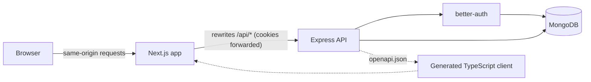

# Doctor Tracker API

Doctor Tracker is an admin portal for managing doctors and the patients under their care. This repository is its REST API: a standalone Express server on MongoDB that handles sign-in, doctor and patient records with fast search, filtering and pagination, and the aggregated analytics behind the dashboard. Every endpoint is validated, documented and typed from a single definition, so the Next.js frontend talks to it through a generated, type-safe client.

The frontend lives in a separate repository: `doctor-tracker-frontend`.

## Stack

- **Runtime:** Node.js 24, Express 5, TypeScript
- **Database:** MongoDB with Mongoose 9
- **Auth:** better-auth (database sessions in httpOnly cookies, `admin` and `viewer` roles)
- **Contract:** Zod 4 schemas generating an OpenAPI 3.1 document, served with Scalar
- **Tests:** Vitest and Supertest against an in-memory MongoDB replica set

## Setup guide

You need Node.js 24 or later, pnpm, and Docker for the local database.

```bash
# 1. Install dependencies
pnpm install

# 2. Create your environment file and set a secret
cp .env.example .env
openssl rand -base64 32   # paste the output as BETTER_AUTH_SECRET in .env

# 3. Start MongoDB (a single-node replica set in Docker)
pnpm db:up

# 4. Create the demo accounts, 300 doctors and 30,000 patients
pnpm seed

# 5. Start the API with reload
pnpm dev
```

The API listens on `http://localhost:4000`:

| URL             | What it is                                                 |
| --------------- | ---------------------------------------------------------- |
| `/docs`         | Interactive API reference (Scalar)                         |
| `/openapi.json` | OpenAPI 3.1 document the frontend client is generated from |
| `/health`       | Liveness and database status                               |
| `/api/auth/*`   | Sign-in, sign-out and session endpoints (better-auth)      |
| `/api/v1/*`     | Doctors, patients and analytics                            |

Demo accounts created by the seed script:

| Role   | Email                      | Password       | Can do                       |
| ------ | -------------------------- | -------------- | ---------------------------- |
| Admin  | `admin@doctortracker.dev`  | `Admin@12345`  | Everything                   |
| Viewer | `viewer@doctortracker.dev` | `Viewer@12345` | Read only; writes return 403 |

There is no public sign-up. Accounts are created by the seed script.

### Scripts

| Command                                        | Purpose                                                                    |
| ---------------------------------------------- | -------------------------------------------------------------------------- |
| `pnpm dev`                                     | Run the API with reload                                                    |
| `pnpm build` / `pnpm start`                    | Compile to `dist/` and run the compiled server                             |
| `pnpm test`                                    | Run unit and integration tests                                             |
| `pnpm typecheck` / `pnpm lint` / `pnpm format` | Static checks and formatting                                               |
| `pnpm seed`                                    | Create accounts and demo data (`pnpm seed --fresh` replaces existing data) |
| `pnpm openapi`                                 | Write `openapi.json` without starting the server                           |
| `pnpm db:up` / `pnpm db:down`                  | Start or stop the local MongoDB container                                  |

### Environment variables

| Variable                        | Purpose                                                                           |
| ------------------------------- | --------------------------------------------------------------------------------- |
| `MONGODB_URI`                   | MongoDB connection string. Must be a replica set (Atlas, or the local container). |
| `BETTER_AUTH_SECRET`            | Signs session cookies. At least 32 characters.                                    |
| `WEB_ORIGIN`                    | Origin of the Next.js app. Auth cookies are issued for it and CORS allows it.     |
| `API_URL`                       | Public URL of this API.                                                           |
| `TRUSTED_ORIGINS`               | Optional, comma-separated. Extra origins allowed to sign in and call the API.     |
| `TRUST_PROXY`                   | Number of reverse proxies in front of the API.                                    |
| `PORT`, `LOG_LEVEL`, `NODE_ENV` | Standard runtime settings.                                                        |

## System architecture



The browser only ever talks to the Next.js origin, which forwards `/api/*` to this server. That keeps the session cookie first-party and httpOnly even though the two apps are deployed on different domains, so no token is ever exposed to JavaScript and no cross-site cookie is needed.

Inside the API a request passes through these layers:

1. **Middleware:** request logging, CORS, security headers, JSON parsing.
2. **Session check:** `requireAuth` resolves the better-auth session and attaches the user and role.
3. **Route definition:** checks the role, then validates `params`, `query` and `body` with Zod.
4. **Service:** builds the MongoDB query and maps documents to response objects.
5. **Error handler:** converts every failure into one JSON shape with the right status.

```
src/
  server.ts            Startup: connect, build indexes, listen, graceful shutdown
  app.ts               Express app: middleware, docs, auth and API routes
  routes.ts            The list of all route definitions
  config/env.ts        Environment variables, validated at startup
  auth/                better-auth instance and the session middleware
  lib/                 Route helper, shared schemas, query helpers, search, errors
  modules/
    doctors/           schema (Zod) · model (Mongoose) · service · routes
    patients/          schema · model · service · routes
    analytics/         schema · service · routes
  openapi/             OpenAPI document builder
  db/                  Connection, index setup, seed script
tests/                 Unit and integration tests
```

### API conventions

- **Lists** return `{ data: [...], meta: { page, limit, total, totalPages } }` and accept `page`, `limit` (max 100), `search`, `sort` (`-createdAt`, `createdAt`, `name`, `-name`), `from` and `to`.
- **Errors** return `{ error: { code, message, details? } }`. Validation failures list every invalid field as `{ path, message }`.
- **Status codes:** 400 validation, 401 not signed in, 403 wrong role, 404 missing, 409 conflict (duplicate email, or deleting a doctor who still has patients).

| Area                | Endpoints                                                                                                              |
| ------------------- | ---------------------------------------------------------------------------------------------------------------------- |
| Doctors             | `GET/POST /doctors`, `GET /doctors/filters`, `GET/PATCH/DELETE /doctors/{id}`                                          |
| A doctor's patients | `GET/POST /doctors/{id}/patients`, `DELETE /doctors/{id}/patients/{patientId}`                                         |
| Patients            | `GET/POST /patients`, `GET/PATCH/DELETE /patients/{id}`                                                                |
| Analytics           | `GET /analytics/summary`, `/registrations`, `/patients-per-doctor`, `/conditions`, `/specializations`, `/demographics` |

## Technical decisions

### 1. Search as an indexed prefix match on word tokens

Search has to feel like type-ahead: typing `rah card` should find Dr. Rahman in Cardiology. MongoDB offers three built-in ways to do this and each falls short here:

| Option                 | Problem                                                                                                |
| ---------------------- | ------------------------------------------------------------------------------------------------------ |
| `$regex` on each field | An unanchored or case-insensitive regex cannot use index bounds, so every search scans the collection. |
| `$text` index          | Matches whole words only. `rah` does not find `Rahman`.                                                |
| Atlas Search           | Solves it, but ties the project to Atlas and cannot run in a plain local MongoDB.                      |

Instead, each document stores a `searchTokens` array: the lowercase words of its searchable fields (name, specialization, hospital, email, diagnosis) plus the digits of its phone number. The array has an ordinary multikey index. A search splits the input into words and requires each one to prefix-match a token with an anchored, case-sensitive regex, which MongoDB executes as an index range scan.

Measured on the seeded data (300 doctors, 30,000 patients), searching doctors for `rah` examines 23 index keys and 11 documents instead of scanning all 300, and the cost grows with the number of matches rather than the size of the collection.

The trade-offs are deliberate:

- Tokens must be rebuilt on every write. A Mongoose `pre("save")` hook does this, so creates and updates go through `save()`.
- It matches the start of words, not the middle, and has no typo tolerance. For an admin list that is the expected behaviour; Atlas Search is the upgrade path if fuzzy matching is ever needed.
- Search results are sorted in memory, which is cheap because a search narrows the set first.

The other list queries follow the equality, sort, range rule for compound indexes. Each filter index ends in `createdAt, _id`, so a filtered page comes straight off the index in sorted order with no in-memory sort, and `_id` as the final key makes page boundaries stable.

### 2. One route definition as the source of truth for the contract

Each endpoint is declared once with `defineRoute`: its path, required role, Zod schemas for `params`, `query` and `body`, and its response schema. That single object is used three ways:

- **Validation:** the route helper parses the request and rejects bad input before the handler runs.
- **Types:** the handler receives the parsed, typed input, and must return a value that matches the response schema, checked at compile time.
- **Documentation:** the same schemas generate the OpenAPI document, which Scalar renders at `/docs` and which the frontend uses to generate its client and query hooks.

The alternative is the common Express pattern of hand-written validation middleware, separately maintained Swagger comments, and hand-typed fetch calls in the frontend. Those three drift apart silently. Here they cannot: changing a field in a Zod schema changes the validation, the handler types, the published document and, after regeneration, the frontend types, and a mismatch is a compile error rather than a runtime surprise.

Mongoose still owns persistence, and its schemas repeat the field list. A `satisfies` check ties the two together: adding a field to the Zod contract without adding it to the Mongoose schema fails the build.

## Query performance

Plans were captured with `explain("executionStats")` against the seeded data.

| Query                                       | Winning plan                             | Keys examined | Documents examined |
| ------------------------------------------- | ---------------------------------------- | ------------- | ------------------ |
| Patients, newest first, page 1              | `IXSCAN createdAt_-1__id_-1`             | 10            | 10                 |
| Patients of one doctor                      | `IXSCAN doctor_1_createdAt_-1__id_-1`    | 10 or fewer   | 10 or fewer        |
| Patients with `condition=critical`, page 50 | `IXSCAN condition_1_createdAt_-1__id_-1` | 500           | 10                 |
| Patients, page 2000 of 3000                 | `IXSCAN createdAt_-1__id_-1` with skip   | 20,000        | 10                 |
| Doctors matching `rah`                      | `IXSCAN searchTokens_1`                  | 23            | 11                 |
| Count of critical patients                  | `COUNT_SCAN` on the condition index      | 2,417         | 0                  |
| Patients per doctor (dashboard)             | Covered `IXSCAN` on the doctor index     | 30,000        | 0                  |
| Registrations in the last 30 days           | Covered `IXSCAN` on `createdAt`          | 3,360         | 0                  |
| Distinct specializations                    | `DISTINCT_SCAN`                          | one per value | 0                  |

Points worth noting:

- **No collection scans on list pages.** Skipped rows on deep pages are skipped in the index; only the returned rows are fetched.
- **Covered aggregations.** A `$group` on its own scans every document. Adding `$sort` on the indexed field first lets MongoDB answer from the index alone, which took the patients-per-doctor query from 30,000 documents read to zero.
- **Totals are cheap.** Unfiltered totals use collection metadata; filtered totals are index-only counts that run in parallel with the page query.
- **No N+1 queries.** Patient counts for a page of doctors come from one indexed aggregation, and doctor details for a page of patients from one `populate`.
- **A deliberate non-index.** `gender` has three values, so it has no index; the query walks the `createdAt` index and filters. Its worst case, the rarest value, examines about 1,250 keys for a page.

## Security

- Passwords are hashed by better-auth and never returned. Sessions live in MongoDB and can be revoked.
- Session cookies are httpOnly and `SameSite=Lax`, and `Secure` over HTTPS. The API accepts JSON bodies only, so a cross-site form cannot forge a write.
- Every `/api/v1` route requires a session; routes that change data also require the `admin` role.
- Request data is validated before it reaches a query, and Mongoose runs with `strictQuery: "throw"`, so unknown filter paths are rejected rather than ignored.
- Sign-in attempts are rate limited in production, and responses carry `helmet` security headers.

## Testing

`pnpm test` runs 30 tests in a few seconds. Integration tests start an in-memory MongoDB replica set, sign in real sessions, and cover access control, validation, conflicts, search, filters, pagination and each analytics endpoint. One test asserts on the query plan itself, so removing an index fails the suite.

## Deployment

The `Dockerfile` builds a production image that runs `node dist/server.js` as a non-root user, with a health check on `/health`. Set the environment variables from the table above, point `MONGODB_URI` at MongoDB Atlas, and set `TRUST_PROXY` to the number of proxies in front of the container. Indexes are created on startup.

To seed a hosted database, run the seed script locally with its connection string:

```bash
MONGODB_URI="mongodb+srv://..." pnpm seed
```

## Scaling further

- **Deep pagination:** offset paging reads skipped index keys. Past a few hundred thousand rows, switch the lists to keyset pagination on `(createdAt, _id)`, which the existing indexes already support.
- **Dashboard load:** the analytics endpoints are independent and read-only, so they can be cached for a short time or served from a read replica.
- **Patient counts:** if doctors need to be sorted by patient count, store a counter on the doctor and update it in the same transaction as the patient write.
- **Search:** move to Atlas Search when fuzzy or relevance-ranked matching is needed.
