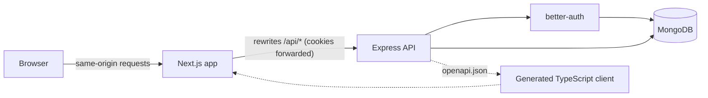

# Doctor Tracker API

Doctor Tracker is an admin portal for managing doctors and the patients under their care. This repository is its REST API: a standalone Express server on MongoDB that handles sign-in and user accounts, doctor and patient records with fast search, filtering and pagination, and the aggregated analytics behind the dashboard. Every endpoint is validated, documented and typed from a single definition, so the Next.js frontend talks to it through a generated, type-safe client.

The frontend lives in a separate repository: `doctor-tracker-frontend`.

## Stack

- **Runtime:** Node.js 24, Express 5, TypeScript
- **Database:** MongoDB with Mongoose 9
- **Auth:** better-auth (database sessions in httpOnly cookies, checked on every request; `admin` and `viewer` roles)
- **Contract:** Zod 4 schemas generating an OpenAPI 3.1 document, served with Scalar
- **Tests:** Vitest and Supertest against an in-memory MongoDB replica set

## Setup guide

You need Node.js 24 or later, pnpm, and Docker for the local database.

```bash
# 1. Install dependencies
pnpm install

# 2. Create your environment file, set a secret and choose the first admin
cp .env.example .env
openssl rand -base64 32   # paste the output as BETTER_AUTH_SECRET in .env
# then set SEED_ADMIN_EMAIL and SEED_ADMIN_PASSWORD (12 characters or more) in .env

# 3. Start MongoDB (a single-node replica set in Docker)
pnpm db:up

# 4. Create the admin account, 300 doctors and 30,000 patients
pnpm seed

# 5. Start the API with reload
pnpm dev
```

The API listens on `http://localhost:4000`:

| URL             | What it is                                                 |
| --------------- | ---------------------------------------------------------- |
| `/docs`         | Interactive API reference (Scalar)                         |
| `/openapi.json` | OpenAPI 3.1 document the frontend client is generated from |
| `/health`       | Liveness and database status                               |
| `/api/auth/*`   | Sign-in, sign-out and session endpoints (better-auth)      |
| `/api/v1/*`     | Doctors, patients, analytics and users                     |

### Accounts

No account or password is published in this repository. The seed script creates the first admin from `SEED_ADMIN_EMAIL` and `SEED_ADMIN_PASSWORD`, which have no defaults; after that, admins add everyone else from the Users page, and there is no public sign-up.

| Role   | Can do                                                   |
| ------ | -------------------------------------------------------- |
| Admin  | Everything, including adding and managing users          |
| Viewer | Read only; writes and every `/users` endpoint return 403 |

How the seed treats the `SEED_*` variables:

- **Admin pair set:** the account is created, or an existing one is given that name and role, reactivated, and its password replaced if it differs (which also signs it out everywhere). Re-running the seed is how a forgotten admin password is recovered.
- **Admin pair not set:** fine once an active admin exists; the seed says it is keeping them and seeds the data. On a database with no active admin it stops before writing anything, since nobody could sign in to the result.
- **Viewer pair:** optional, same rules.
- **Only one of a pair set, an invalid email, or a short password:** the seed stops before writing anything and names the variable.

Once the first admin exists, the `SEED_*` lines can be left blank, so no password has to stay in `.env`.

### Scripts

| Command                                        | Purpose                                                                  |
| ---------------------------------------------- | ------------------------------------------------------------------------ |
| `pnpm dev`                                     | Run the API with reload                                                  |
| `pnpm build` / `pnpm start`                    | Compile to `dist/` and run the compiled server                           |
| `pnpm test`                                    | Run unit and integration tests                                           |
| `pnpm typecheck` / `pnpm lint` / `pnpm format` | Static checks and formatting                                             |
| `pnpm seed`                                    | Create the `SEED_*` accounts and demo data (`--fresh` replaces the data) |
| `pnpm openapi`                                 | Write `openapi.json` without starting the server                         |
| `pnpm db:up` / `pnpm db:down`                  | Start or stop the local MongoDB container                                |
| `pnpm db:recount`                              | Recompute stored patient counts and condition ranks from the patients    |

### Environment variables

| Variable                                    | Purpose                                                                           |
| ------------------------------------------- | --------------------------------------------------------------------------------- |
| `MONGODB_URI`                               | MongoDB connection string. Must be a replica set (Atlas, or the local container). |
| `BETTER_AUTH_SECRET`                        | Signs session cookies. At least 32 characters.                                    |
| `WEB_ORIGIN`                                | Origin of the Next.js app. Auth cookies are issued for it and CORS allows it.     |
| `API_URL`                                   | Public URL of this API.                                                           |
| `TRUSTED_ORIGINS`                           | Optional, comma-separated. Extra origins allowed to sign in and call the API.     |
| `TRUST_PROXY`                               | Number of reverse proxies in front of the API.                                    |
| `PORT`, `LOG_LEVEL`, `NODE_ENV`             | Standard runtime settings.                                                        |
| `SEED_ADMIN_EMAIL`, `SEED_ADMIN_PASSWORD`   | `pnpm seed` only. The first admin; required until an active admin exists.         |
| `SEED_VIEWER_EMAIL`, `SEED_VIEWER_PASSWORD` | `pnpm seed` only. An optional read-only account.                                  |
| `SEED_ADMIN_NAME`, `SEED_VIEWER_NAME`       | `pnpm seed` only. Display names; optional.                                        |

## System architecture



The browser only ever talks to the Next.js origin, which forwards `/api/*` to this server. That keeps the session cookie first-party and httpOnly even though the two apps are deployed on different domains, so no token is ever exposed to JavaScript and no cross-site cookie is needed.

Inside the API a request passes through these layers:

1. **Middleware:** request logging, CORS, security headers, JSON parsing.
2. **Session check:** `requireAuth` resolves the better-auth session and attaches the user and role.
3. **Route definition:** checks the role, then validates `params`, `query` and `body` with Zod.
4. **Service:** builds the MongoDB query and maps documents to response objects.
5. **Error handler:** converts every failure into one JSON shape with the right status.

```
src/
  server.ts            Startup: connect, build indexes, listen, graceful shutdown
  app.ts               Express app: middleware, docs, auth and API routes
  routes.ts            The list of all route definitions
  config/env.ts        Environment variables, validated at startup
  auth/                better-auth instance and the session middleware
  lib/                 Route helper, shared schemas, query helpers, search, errors
  modules/
    doctors/           schema (Zod) · model (Mongoose) · service · routes
    patients/          schema · model · service · routes
    analytics/         schema · service · routes
    users/             schema · read model · service · routes
  openapi/             OpenAPI document builder
  db/                  Connection, index setup, seed (data and accounts) and recount scripts
tests/                 Unit and integration tests
```

### API conventions

- **Lists** return `{ data: [...], meta: { page, limit, total, totalPages } }` and accept `page`, `limit` (max 100), `search`, `sort`, `from` and `to`.
- **Sorting** takes a field, with a leading `-` for descending; the default is `-createdAt`. Doctors sort by `createdAt`, `name`, `specialization`, `hospital` or `patientCount`. Patients sort by `createdAt`, `name`, `age` or `condition`, which orders by severity: `-condition` lists critical patients first. Ties break newest first, and the descending form is the exact reverse.
- **Time zones:** analytics that group by day, month or hour take an IANA `timezone` (default `UTC`).
- **Errors** return `{ error: { code, message, details? } }`. Validation failures list every invalid field as `{ path, message }`.
- **Status codes:** 400 validation, 401 not signed in, 403 wrong role or a change to your own account, 404 missing, 409 conflict (duplicate email, or deleting a doctor who still has patients).

| Area                | Endpoints                                                                      |
| ------------------- | ------------------------------------------------------------------------------ |
| Doctors             | `GET/POST /doctors`, `GET /doctors/filters`, `GET/PATCH/DELETE /doctors/{id}`  |
| A doctor's patients | `GET/POST /doctors/{id}/patients`, `DELETE /doctors/{id}/patients/{patientId}` |
| Patients            | `GET/POST /patients`, `GET/PATCH/DELETE /patients/{id}`                        |
| Analytics           | `GET /analytics/*` (below) and `GET /doctors/{id}/analytics`                   |
| Users (admins only) | `GET/POST /users`, `PATCH/DELETE /users/{id}`, `POST /users/{id}/password`     |

Doctor responses include `patientCount` and `conditionCounts: { stable, recovering, under_observation, critical }`.

| Analytics endpoint                                                  | Returns                                                                       |
| ------------------------------------------------------------------- | ----------------------------------------------------------------------------- |
| `/analytics/summary?range`                                          | Totals, new doctors and patients, and the previous window for comparison      |
| `/analytics/registrations?range&interval=auto\|day\|month&timezone` | A gap-free series of new patients and doctors; `12m&interval=day` is 365 days |
| `/analytics/intake-hours?range&timezone`                            | All 168 weekday and hour cells (0 is Sunday) and the largest cell             |
| `/analytics/patients-per-doctor?limit&condition`                    | The busiest doctors, optionally counting one condition only                   |
| `/analytics/conditions`                                             | Patients per condition                                                        |
| `/analytics/condition-mix?by=specialization\|hospital`              | Doctors, patients and each condition per group, most patients first           |
| `/analytics/specializations`                                        | Doctors and patients per specialization                                       |
| `/analytics/workload`                                               | Average, median, p90 and max patients per doctor, and 8 to 12 equal buckets   |
| `/analytics/demographics`                                           | Patients by gender and age group                                              |
| `/doctors/{id}/analytics?timezone`                                  | One doctor's conditions, last 12 months, age groups and genders               |

`range` is `7d`, `30d`, `90d` or `12m` (365 days), ending now. It defaults to `30d`, except intake hours, which default to `90d`.

**Users.** Every `/users` endpoint needs the `admin` role. A user is `{ id, name, email, role, status, deactivatedAt, createdAt }`, where `status` is `active` or `deactivated`; passwords are never returned.

| Endpoint                    | Body                          | Does                                                                                                                                                   |
| --------------------------- | ----------------------------- | ------------------------------------------------------------------------------------------------------------------------------------------------------ |
| `GET /users`                |                               | Lists users. `search` matches the start of words in name and email; filters `role`, `status`, `from`, `to`; sorts `createdAt`, `name`, `email`, `role` |
| `POST /users`               | `name, email, role, password` | Creates a user who can sign in with that password. 409 on `body.email` if taken                                                                        |
| `PATCH /users/{id}`         | any of `name, role, status`   | Renames, changes the role, deactivates or reactivates                                                                                                  |
| `POST /users/{id}/password` | `password`                    | Replaces the password (204)                                                                                                                            |
| `DELETE /users/{id}`        |                               | Deletes the user and their sign-in (204)                                                                                                               |

The rules are enforced in the service, and each has a test:

- **Email is unique**, ignoring case, including under two simultaneous creates.
- **Not on yourself:** an admin cannot change their own role, deactivate, delete or reset the password of their own account (403 `OWN_ACCOUNT`). Your own password is changed through better-auth's `POST /api/auth/change-password`, which needs the current one.
- **At least one active admin remains**, also when two admins try to remove each other at the same moment (Technical decision 5).
- **Deactivated means out:** a deactivated user's sessions end at once and sign-in answers 403 `ACCOUNT_DEACTIVATED`, but only after a correct password, so the status tells a stranger nothing.
- **Sessions end on every change that matters:** a role change, password reset, deactivation or deletion signs the user out everywhere. Changing your own password signs out your other devices.
- **One password rule everywhere:** 12 to 128 characters for the seed, create, reset and change, in better-auth's config and the route schemas alike.

## Technical decisions

### 1. Search as an indexed prefix match on word tokens

Search has to feel like type-ahead: typing `rah card` should find Dr. Rahman in Cardiology. MongoDB offers three built-in ways to do this and each falls short here:

| Option                 | Problem                                                                                                |
| ---------------------- | ------------------------------------------------------------------------------------------------------ |
| `$regex` on each field | An unanchored or case-insensitive regex cannot use index bounds, so every search scans the collection. |
| `$text` index          | Matches whole words only. `rah` does not find `Rahman`.                                                |
| Atlas Search           | Solves it, but ties the project to Atlas and cannot run in a plain local MongoDB.                      |

Instead, each document stores a `searchTokens` array: the lowercase words of its searchable fields (name, specialization, hospital, email, diagnosis) plus the digits of its phone number. The array has an ordinary multikey index. A search splits the input into words and requires each one to prefix-match a token with an anchored, case-sensitive regex, which MongoDB executes as an index range scan.

Measured on the seeded data (300 doctors, 30,000 patients), searching doctors for `rah` examines 23 index keys and 11 documents instead of scanning all 300, and the cost grows with the number of matches rather than the size of the collection.

The trade-offs are deliberate:

- Tokens must be rebuilt on every write. A Mongoose `pre("save")` hook does this, so creates and updates go through `save()`.
- It matches the start of words, not the middle, and has no typo tolerance. For an admin list that is the expected behaviour; Atlas Search is the upgrade path if fuzzy matching is ever needed.
- Search results are sorted in memory, which is cheap because a search narrows the set first.

The other list queries follow the equality, sort, range rule for compound indexes. Each filter index ends in `createdAt, _id`, so a filtered page comes straight off the index in sorted order with no in-memory sort, and `_id` as the final key makes page boundaries stable.

### 2. One route definition as the source of truth for the contract

Each endpoint is declared once with `defineRoute`: its path, required role, Zod schemas for `params`, `query` and `body`, and its response schema. That single object is used three ways:

- **Validation:** the route helper parses the request and rejects bad input before the handler runs.
- **Types:** the handler receives the parsed, typed input, and must return a value that matches the response schema, checked at compile time.
- **Documentation:** the same schemas generate the OpenAPI document, which Scalar renders at `/docs` and which the frontend uses to generate its client and query hooks.

The alternative is the common Express pattern of hand-written validation middleware, separately maintained Swagger comments, and hand-typed fetch calls in the frontend. Those three drift apart silently. Here they cannot: changing a field in a Zod schema changes the validation, the handler types, the published document and, after regeneration, the frontend types, and a mismatch is a compile error rather than a runtime surprise.

Mongoose still owns persistence, and its schemas repeat the field list. A `satisfies` check ties the two together: adding a field to the Zod contract without adding it to the Mongoose schema fails the build.

### 3. A stored patient count, kept exact with transactions

Each doctor document stores `patientCount`. Creating a patient, deleting one and moving one to another doctor each change the patient and the affected counters in one MongoDB transaction, so the count and the patients collection cannot disagree.

The alternative is to count patients when reading, which is what this API did before. That works for showing a count on a page of ten doctors, but it cannot be sorted on through an index, and every ranking or distribution has to group the whole patients collection: the top-doctors chart read 30,000 index keys on every request.

The counter is a deliberate trade-off of write cost for read speed:

| Cost                                                                                                                                                                                                                                                                    | Gain                                                                                                                                                     |
| ----------------------------------------------------------------------------------------------------------------------------------------------------------------------------------------------------------------------------------------------------------------------- | -------------------------------------------------------------------------------------------------------------------------------------------------------- |
| Every patient create, move and delete is a transaction with one or two extra document writes and index updates.                                                                                                                                                         | Doctor list and detail read the field; nothing is counted per request.                                                                                   |
| Concurrent writes for the same doctor conflict on its document. The driver retries them with backoff, and the doctor write is the last statement, which keeps the window short. A burst of 25 concurrent creates for one doctor ends with the exact count in the tests. | Doctors sort by `patientCount` straight off an index, in both directions.                                                                                |
| Transactions need a replica set. Atlas, the local container and the test server are all replica sets.                                                                                                                                                                   | The top-doctors ranking reads 10 index keys instead of 30,000, and the workload histogram reads one key per doctor.                                      |
| Data written outside the API can leave a counter wrong.                                                                                                                                                                                                                 | Deleting a doctor becomes one conditional delete on `patientCount: 0`, which closes the race where a patient is added while the doctor is being deleted. |

`pnpm db:recount` is the repair path for the last row. It recomputes every counter with one covered aggregation over the patients and one bulk write, inside a transaction, and rewrites only counters that are wrong. It also fills in `conditionRank` (below) on patients written before it existed.

### 4. Indexes, and why each one exists

Every list sort is the order of one index, ending in `_id`, so an unfiltered page never sorts in memory. Descending sorts walk the same index backwards. Condition sorts by severity, so patients also store `conditionRank` (1 stable to 4 critical), set by the same pre-save hook that builds the search tokens; the condition filter uses it too, so one index serves the filter, both sort directions and the breakdown.

| Doctors                          | Serves                                                                                  |
| -------------------------------- | --------------------------------------------------------------------------------------- |
| `email` (unique)                 | Rejecting duplicate emails                                                              |
| `createdAt, _id`                 | The default newest-first list, `createdAt` sorts, date filters, new-doctor counts       |
| `specialization, createdAt, _id` | The specialization filter and sort; doctor counts for the condition mix (covered)       |
| `hospital, createdAt, _id`       | The hospital filter and sort; doctor counts for the condition mix by hospital (covered) |
| `name, _id`                      | `name` sorts                                                                            |
| `patientCount, createdAt, _id`   | `patientCount` sorts, the top-doctors ranking and the workload histogram (covered)      |
| `searchTokens`                   | Search                                                                                  |

| Patients                                | Serves                                                                                                                                             |
| --------------------------------------- | -------------------------------------------------------------------------------------------------------------------------------------------------- |
| `createdAt, _id`                        | The default list, registrations, intake hours and summary windows (covered)                                                                        |
| `doctor, createdAt, _id`                | One doctor's patients newest first; that doctor's monthly series (covered)                                                                         |
| `doctor, conditionRank, createdAt, _id` | One doctor's patients by severity or filtered by condition; condition counts per doctor, the condition mix and the condition ranking (all covered) |
| `conditionRank, createdAt, _id`         | The condition filter, `condition` sorts, the condition breakdown and the critical count                                                            |
| `name, _id`                             | `name` sorts                                                                                                                                       |
| `age, createdAt, _id`                   | `age` sorts                                                                                                                                        |
| `searchTokens`                          | Search                                                                                                                                             |

`conditionRank, createdAt, _id` replaces the earlier index on the condition label. The server only creates missing indexes on startup; `pnpm seed` also drops indexes the code no longer defines.

One doctor's patient list is pinned to the two indexes that start with `doctor`. Left to the planner, a `name` sort for the busiest doctor (476 patients) picks the global `name` index, and once that plan is cached, a doctor with one patient walks the whole name index until MongoDB replans. With the hint, the worst case is that doctor's own rows sorted in memory.

### 5. Users through better-auth's internals, not its admin plugin

better-auth owns the `user`, `account` and `session` collections, so user management goes through it rather than around it. It offers two ways in, and this API uses the second:

| Option                                                      | Why not, or why                                                                                                                                                                                                                                                                                                                                                                |
| ----------------------------------------------------------- | ------------------------------------------------------------------------------------------------------------------------------------------------------------------------------------------------------------------------------------------------------------------------------------------------------------------------------------------------------------------------------ |
| The admin plugin                                            | Its endpoints would mount at `/api/auth/admin/*` beside this API, as a second user-management surface that enforces none of the rules above: an admin could demote themselves or the last admin, and a role change or password reset would leave sessions open. With them disabled, what remains is a ban flag and a sign-in hook, which this API configures in a dozen lines. |
| The internal adapter and password helpers (`auth.$context`) | The same calls better-auth's own endpoints make: `createUser`, `linkAccount`, `updateUser`, `updatePassword`, `deleteUserSessions`, `deleteUser`, and its scrypt `password.hash`. The service wraps them in better-auth's `runWithTransaction`, so a user and their credential are created together, and a change and the end of that user's sessions commit together.         |

Three details make the rules hold:

- **Sessions are read on every request.** better-auth's cookie cache would let a revoked session or an old role live on in a signed cookie for minutes, so it is off; each request reads its session by token from MongoDB, an indexed lookup. Deleting a user's sessions therefore takes effect on their next request.
- **The last admin cannot be removed, even concurrently.** Only another admin can demote, deactivate or delete an admin, so one always remains, unless two admins remove each other at the same moment. Inside the transaction, the service re-reads the acting admin, refuses if they are no longer an active admin, and writes their record. Two admins removing each other then write the same two documents, MongoDB aborts one transaction with a write conflict, and the driver retries it, now seeing that its actor was removed. The tests run that race for demote, deactivate and delete, and fail if the write is taken out.
- **Indexes better-auth does not create.** Its MongoDB adapter builds none of the indexes declared on better-auth's own tables. Startup creates them under better-auth's own names: a unique `user.email` (better-auth otherwise checks uniqueness by reading first, which two simultaneous creates both pass), `session.token` for the lookup on every request, and `session.userId` and `account.userId` for sign-in and revocation.

The users list reads the `user` collection through a read-only Mongoose model, so it shares the list contract of doctors and patients. Its search is a case-insensitive regex anchored at word starts rather than the indexed token search, because the collection holds staff accounts, not tens of thousands of records.

## Query performance

Plans were captured with `explain("executionStats")` on MongoDB 8 against the seeded data (300 doctors, 30,000 patients). "Covered" means the plan is `PROJECTION_COVERED` over the index: no document is read.

**Lists**

| Query                                             | Winning plan                                                  | Keys examined | Documents examined |
| ------------------------------------------------- | ------------------------------------------------------------- | ------------- | ------------------ |
| Patients, newest first, page 1                    | `IXSCAN createdAt_-1__id_-1`                                  | 10            | 10                 |
| Patients, page 2000 of 3000                       | `IXSCAN createdAt_-1__id_-1` with skip                        | 20,000        | 10                 |
| Patients by `-condition` (critical first), page 1 | `IXSCAN conditionRank_1_createdAt_-1__id_-1`, backwards       | 10            | 10                 |
| Patients by `condition`, page 50                  | `IXSCAN conditionRank_1_createdAt_-1__id_-1` with skip        | 500           | 10                 |
| Patients by `age`, page 1                         | `IXSCAN age_1_createdAt_-1__id_-1`                            | 10            | 10                 |
| Patients with `condition=critical`, page 50       | `IXSCAN conditionRank_1_createdAt_-1__id_-1` with skip        | 500           | 10                 |
| Busiest doctor's patients (476), newest first     | `IXSCAN doctor_1_createdAt_-1__id_-1`                         | 10            | 10                 |
| Busiest doctor's patients by `-condition`         | `IXSCAN doctor_1_conditionRank_1_createdAt_-1__id_-1`         | 10            | 10                 |
| Busiest doctor's patients by `name`               | `IXSCAN doctor_1_createdAt_-1__id_-1` (hinted), then `SORT`   | 476           | 476                |
| Doctors by `-patientCount`, page 1                | `IXSCAN patientCount_1_createdAt_-1__id_-1`, backwards        | 10            | 10                 |
| Doctors by `patientCount`, last page              | `IXSCAN patientCount_1_createdAt_-1__id_-1` with skip         | 300           | 10                 |
| Doctors by `-specialization`, page 1              | `IXSCAN specialization_1_createdAt_-1__id_-1`, backwards      | 10            | 10                 |
| Doctors matching `rah`                            | `IXSCAN searchTokens_1`                                       | 23            | 11                 |
| Condition counts for a page of 10 doctors         | Covered `IXSCAN doctor_1_conditionRank_1_createdAt_-1__id_-1` | 44            | 0                  |

**Analytics**

| Query                                         | Winning plan                                                  | Keys examined | Documents examined                  |
| --------------------------------------------- | ------------------------------------------------------------- | ------------- | ----------------------------------- |
| Count of critical patients                    | `COUNT_SCAN` on `conditionRank_1_createdAt_-1__id_-1`         | 2,408         | 0                                   |
| Patients per doctor (top 10)                  | `IXSCAN patientCount_1_createdAt_-1__id_-1`, backwards        | 10            | 10                                  |
| Patients per doctor, `condition=critical`     | Covered `IXSCAN doctor_1_conditionRank_1_createdAt_-1__id_-1` | 2,704         | 0, plus 10 doctors joined by `_id`  |
| Condition mix by specialization, patient side | Covered `IXSCAN doctor_1_conditionRank_1_createdAt_-1__id_-1` | 30,000        | 0, plus each doctor joined by `_id` |
| Condition mix by specialization, doctor side  | Covered `IXSCAN specialization_1_createdAt_-1__id_-1`         | 300           | 0                                   |
| Workload                                      | Covered `IXSCAN patientCount_1_createdAt_-1__id_-1`           | 300           | 0                                   |
| Specializations                               | `COLLSCAN` of doctors, summing `patientCount`                 | 0             | 300                                 |
| Registrations in the last 30 days             | Covered `IXSCAN createdAt_-1__id_-1`                          | 3,170         | 0                                   |
| Registrations, 12 months by day               | Covered `IXSCAN createdAt_-1__id_-1`                          | 26,592        | 0                                   |
| Intake hours, last 90 days                    | Covered `IXSCAN createdAt_-1__id_-1`                          | 9,058         | 0                                   |
| Busiest doctor's analytics: conditions        | Covered `IXSCAN doctor_1_conditionRank_1_createdAt_-1__id_-1` | 476           | 0                                   |
| Busiest doctor's analytics: last 12 months    | Covered `IXSCAN doctor_1_createdAt_-1__id_-1`                 | 332           | 0                                   |
| Busiest doctor's analytics: ages and genders  | `IXSCAN doctor_1_createdAt_-1__id_-1`, then `FETCH`           | 476           | 476                                 |
| Distinct specializations                      | `DISTINCT_SCAN` on `specialization_1_createdAt_-1__id_-1`     | 15            | 0                                   |

Points worth noting:

- **No collection scans on list pages.** Skipped rows on deep pages are skipped in the index; only the returned rows are fetched. The one `COLLSCAN` above reads the 300 doctors, all of which it needs.
- **Covered aggregations.** A `$group` on its own scans every document. Adding `$sort` on the indexed fields first lets MongoDB answer from the index alone. Where a filter is on the second key of an index, as in the condition ranking, the pipeline also states that `doctor` is an ObjectId: that bounds the first key, so the scan seeks to each doctor's slice of the condition instead of fetching all 30,000 patients, as the planner otherwise chose.
- **Bounded per-doctor work.** Every query for one doctor starts with equality on `doctor`, so it reads only that doctor's index range. The doctor detail page reads at most that doctor's patients, never the collection.
- **Totals are cheap.** Unfiltered totals use collection metadata; filtered totals are index-only counts that run in parallel with the page query.
- **No N+1 queries.** Patient counts are stored on the doctor; condition counts for a page of doctors come from one covered aggregation, and doctor details for a page of patients from one `populate`.
- **Exact percentiles without shipping rows.** The workload endpoint groups doctors by their stored count (one row per distinct count, read from the index), then computes nearest-rank median and p90 and the histogram from those rows.
- **A deliberate non-index.** `gender` has three values, so it has no index; the query walks the `createdAt` index and filters. Its worst case, the rarest value, examines 1,157 keys for a page.

## Security

- No account or password is published: the first admin comes from environment variables that have no defaults, and admins add everyone else.
- Passwords are 12 to 128 characters, hashed by better-auth with scrypt and never returned. Sessions live in MongoDB and are read on every request, so revoking one takes effect on the next request. A role change, password reset, deactivation or deletion ends the user's sessions; a password change ends the user's other sessions.
- A deactivated account is refused at sign-in, after the password check, and its open sessions are gone.
- Session cookies are httpOnly and `SameSite=Lax`, and `Secure` over HTTPS. The API accepts JSON bodies only, so a cross-site form cannot forge a write.
- Every `/api/v1` route requires a session; routes that change data, and every `/users` route, also require the `admin` role. There is no public sign-up.
- Request data is validated before it reaches a query, and Mongoose runs with `strictQuery: "throw"`, so unknown filter paths are rejected rather than ignored.
- Sign-in attempts are rate limited in production, and responses carry `helmet` security headers.

## Testing

`pnpm test` runs 127 tests in about ten seconds. Integration tests start an in-memory MongoDB replica set, sign in real sessions, and cover access control, validation, conflicts, search, filters, every sort key, pagination and each analytics endpoint.

- **Users:** every rule in the API conventions above, through real sign-ins: a revoked session gets 401 on its next request, a deactivated user is refused at sign-in, the old password stops working after a reset, and only one of two simultaneous creates with the same email succeeds. Two admins removing each other at once, by demotion, deactivation or deletion, must leave exactly one. Viewers get 403 on every endpoint. The seed's parsing of `SEED_*` and its password rotation are tested too.

- **Counters:** patients are created, moved and deleted through every write endpoint, including failed writes, and 25 concurrent creates for one doctor must end with the exact count. The recount script must repair drifted counters and leave correct ones alone.
- **Query plans:** every unfiltered sort must walk an index with no in-memory sort or collection scan; the per-page condition counts and the condition ranking must read no documents; each doctor analytics pipeline must stay inside that doctor's index range. Removing an index fails the suite.
- **Time zones:** intake hours and monthly series are checked against the same instants grouped by `Intl`, in UTC and Asia/Dhaka.

## Deployment

The `Dockerfile` builds a production image that runs `node dist/server.js` as a non-root user, with a health check on `/health`. Set the environment variables from the table above, point `MONGODB_URI` at MongoDB Atlas, and set `TRUST_PROXY` to the number of proxies in front of the container. Indexes are created on startup.

To seed a hosted database, run the seed script locally with its connection string and the first admin's details:

```bash
MONGODB_URI="mongodb+srv://..." SEED_ADMIN_EMAIL="..." SEED_ADMIN_PASSWORD="..." pnpm seed
```

Databases seeded before this version hold demo accounts whose passwords were published in this repository. Sign in as an admin and delete them from the Users page, or reset their passwords; running the seed with the same email and a new password also replaces it.

When upgrading a database seeded before patient counts and condition ranks existed, run `pnpm db:recount` against it once, or reseed with `pnpm seed --fresh`.

## Scaling further

- **Deep pagination:** offset paging reads skipped index keys. Past a few hundred thousand rows, switch the lists to keyset pagination on `(createdAt, _id)`, which the existing indexes already support.
- **Dashboard load:** the analytics endpoints are independent and read-only, so they can be cached for a short time or served from a read replica.
- **Patient counts:** done; see Technical decision 3. The counter's cost grows with the write rate for a single doctor, not with the size of the collection. If one doctor ever received writes faster than transactions on its document can commit, the counter could be split into a few sub-counters per doctor, summed on read.
- **Long time series:** registrations and intake hours read one index key per patient in the window (26,592 for a year of daily points here). At millions of patients, roll each day's counts into a summary collection with `$merge` and read that instead.
- **Search:** move to Atlas Search when fuzzy or relevance-ranked matching is needed.
